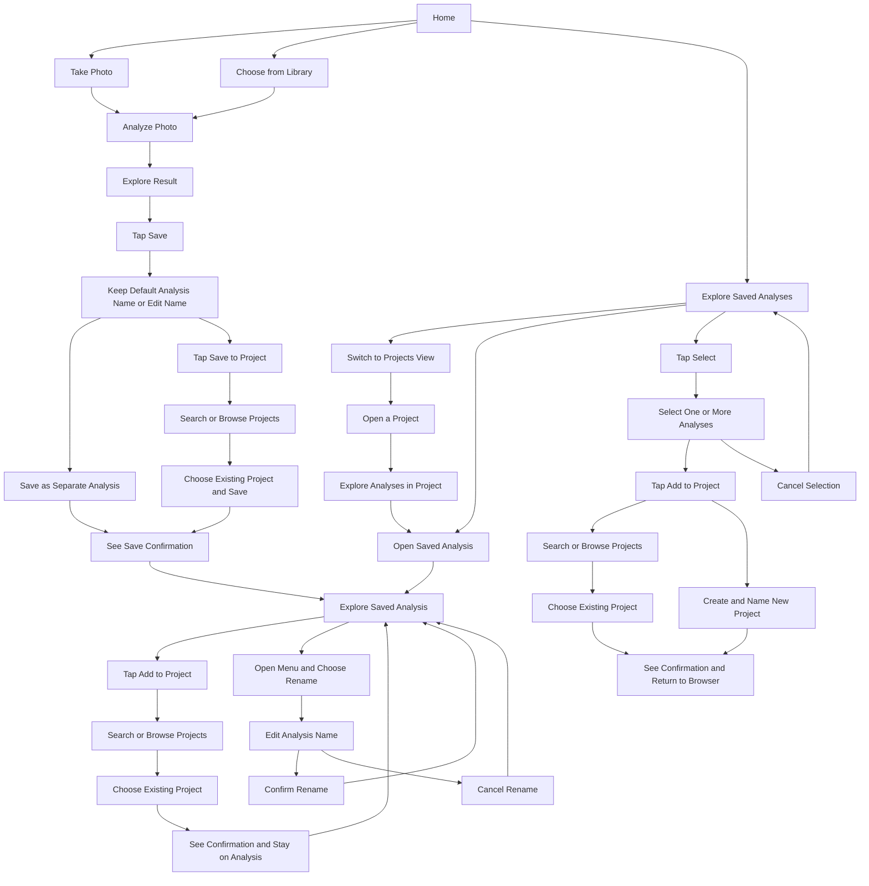

# ColorBalance UX — current flow and wireframes v0.7

This revision supersedes the earlier project-required save design. User requirements: save independently or to an existing project; organize later through browser multi-select or quick Add to Project on an analysis; name and rename analyses. Wireframe presentation remains a design draft. No implementation or usability testing is claimed.

## Current flow

## Wireframe map

ColorBalance_Wireframes_v01.png now contains v0.7, twelve panels in reading order:

1. Home: two large prominent actions, Take Photo and Choose from Library; one secondary Explore Saved Analyses entry. No separate project entry on Home.
2. New result: photo, color percentages, selection, Save.
3. Save: editable default analysis name; primary Save as Separate Analysis and secondary Save to Project. The latter opens panel 13; no inline project list.
4. Saved-analysis browser: All Analyses and Projects views. All Analyses opens by default; named photo cards show project context. Select enters selection mode.
5. Selection mode: one or more cards, selected count, Cancel, Add to Project.
6. Bulk project picker: fixed search and selected count; scrollable existing destinations; Create New Project stays fixed below the list.
7. New project: project name, Create & Add, selected count.
8. Saved result: quick Add to Project, menu for Rename; no Save button.
9. Quick picker: the same search and scrollable destination pattern; confirmation stays on the analysis.
10. Projects view within the same saved-analysis browser: switch between All Analyses and Projects; open a project.
11. Project contents: explore named analyses and open a result.
12. Rename: editable name, Rename or Cancel.
13. Save-to-project picker: search and scroll existing projects; selecting one saves; Back returns to panel 3 retaining the name.

## Decisions and rationale

| Problem | Chosen direction | Alternative considered | Reason / status |
|---|---|---|---|
| Organization interrupts saving | Standalone save, optional existing project | Require project creation | User decision: grouping can happen later |
| Organizing several analyses is repetitive | Browser Select → Add to Project | Open and group each separately | User requested multi-select |
| A single analysis needs quick grouping | Visible Add to Project on saved result | Bury grouping in menu | User requested quick action |
| Default names are hard to recognize | Editable default at save and Rename later | Mandatory naming screen | User confirmed naming is in scope; avoids setup friction |
| Saved viewing suggests unnecessary saving | No Save on saved results | Shared toolbar with new result | User correction: exploration changes no saved content |
| Selection should not require extra confirmation | Tap destination adds/saves immediately | Choose then confirm separately | UX proposal: fewer steps; destructive reassignment must never be implicit |

## Interaction and recovery details

- The save sheet contains the name and two save actions. Choosing a project opens a separate picker; standalone save needs no picker. A date/time default is editable; clearing it uses the default for first save. Renaming requires a nonblank name. Original photo filenames do not change.
- Cancel save returns to the unsaved result. Cancel destination picker returns to its originating page. Back from new project preserves selection and typed name during the grouping flow.
- Browser: all saved analyses, including grouped ones (UX assumption). Tap cards normally to explore; in selection mode tap to toggle. Show count; disable Add to Project at zero. Cancel clears selection. Successful grouping exits selection and retains scroll position.
- Quick add: retain the analysis, highlight selection and scroll position; show confirmation after completion. The analysis is not reanalyzed or duplicated.
- Rename updates the analysis title and browser card; Cancel keeps the original. Failure retains text and offers Retry/Cancel.
- Save failure retains the analysis, name and destination. Grouping failure retains selected IDs and picker; show outcome honestly. If partly applied, report completed and remaining items, retry only unfinished items. Avoid duplicate memberships on retry.
- During saving/grouping/renaming show progress and block repeat submission. Never report success before persistence finishes. Do not imply a committed mutation was canceled if its outcome is unknown.
- No projects: standalone saving remains available; browser bulk grouping offers Create New Project. Quick picker shows No projects yet and a route back to the browser for creating one through grouping.
- Empty browser: Choose Photo / Take Photo. Empty project: explain no analyses and link to saved-analysis browser.
- Permission denied: explain, offer Choose Photo or Settings. Picker cancel preserves previous state. Analysis loading shows a spinner and Cancel, no fabricated percentage. Analysis failure keeps photo and offers Retry/Choose Another.
- Leaving an unsaved result requires discard confirmation only if leaving loses the analysis. Saved-result Back returns to its originating browser/project; after first save, Back returns Home.
- Color exploration keeps percentages visible, supports one selected color at a time, and restores the full photo when selection is cleared. Use visible selected indicators and text labels, not color alone. Wireframes use neutral Color 1/2/3 labels, not unconfirmed automatic color naming.

## Explicit assumptions and open questions

- Whether an analysis can belong to more than one project is not yet decided. Adding must not silently remove membership from another project. Current grouping paths are ready for ungrouped analyses; already-grouped items require this product rule before implementation. Existing membership in the same target must not be duplicated.
- All saved analyses includes grouped items; project labels aid recognition. No search, filters, moving, removing membership, deleting, or reordering are introduced in this pass.
- Default naming format and long-title truncation are UX proposals; full name stays accessible on the analysis and rename dialog.
- Local storage must preserve the photo, palette and region mapping needed for reopening; implementation feasibility is not verified by these wireframes.

## Handoff to Chief of Staff

- From: UX Design.
- Progress: Updated flow and twelve-panel wireframes now match optional project grouping, naming, bulk selection and quick add.
- User decisions: Independent save; later grouping; multi-select in browser; quick existing-project add from analysis; naming/renaming in scope.
- Status: Review draft, not approved visual design or implemented functionality. No recorded hours or roadmap completion claim.
- Next: Review revised screens; resolve project membership rule before implementing grouping for already-grouped items.

## Handoff to Product & Ideas

- User-directed requirements above are reflected in UX, not requests to reapprove them.
- Unresolved product rule: one project per analysis or multiple memberships; bulk operations must not implicitly move existing items.
- UX assumption: saved-analysis browser contains all saved analyses, grouped and standalone.

## Home hierarchy revision

User correction: Take Photo and Choose from Library are the two obvious primary actions. Explore Saved Analyses is the single secondary entry for both saved analyses and projects. UX design choice: All Analyses / Projects views within that browser preserve access to projects without another Home option. Alternative: separate project button on Home; rejected by user to simplify the entry screen.

Chief of Staff handoff: Home hierarchy corrected and both saved artifacts synchronized; design draft remains under review. Product & Ideas handoff: user navigation requirement incorporated; no change to grouping functionality.

## Project-list growth revision

Problem: listing every project in the save sheet grows the sheet and obscures its primary action. Design: compact save sheet with Save to Project opening a scrollable picker; search is always visible in that picker to avoid a changing layout or arbitrary threshold. Alternative: inline scrolling project list; rejected because it competes with naming and standalone saving. Back preserves the entered analysis name. Empty picker explains No projects yet and offers Back to Save; no search matches offers Clear Search; save failure preserves search and analysis. Picker results scroll while heading and Back remain accessible.

Handoff to Chief of Staff: wireframes and flow updated to handle growing project lists; design draft remains under review.

## Consistent project pickers (v0.7)

Pages 06, 09 and 13 use a bounded scrolling result list and persistent search. Page 06 keeps selected count, Cancel, and Create New Project outside the scrolling area. Search matches project names without changing selected analysis IDs. No matches shows Clear Search; page 06 still offers Create New Project. Cancel picker returns to browser selection mode preserving selection; Cancel Selection then clears it. A failed add keeps the picker, query and selection for retry. Page 09 preserves the current analysis when canceled. This resolves project-list growth without adding another step to an already dedicated picker. Alternative: another nested picker screen; rejected as unnecessary navigation. Chief of Staff handoff: picker consistency corrected across bulk grouping, quick grouping and saving; design draft only.

## Per-screen navigation annotations (v0.7)

These notes are also rendered beside all 13 wireframes, outside the app UI. Specific action names replace generic Next.

### Screen 01

- Take Photo → system camera → analysis → 02. Camera Cancel returns here without changes.
- Choose from Library → system photo picker → analysis → 02. Picker Cancel returns here.
- Explore Saved Analyses → 04 (All Analyses view).

### Screen 02

- Save → 03. Keep the photo, computed results and selected color.
- Back → Home (01) only after confirming discard. Keep Exploring cancels leaving; Discard removes this unsaved result.
- Tap color → highlight its regions. Tap again → clear selection; stay here.

### Screen 03

- Cancel → 02. Keep unsaved photo/result; close save flow. Reopening Save starts with default title.
- Save as Separate Analysis → save → 08. Show confirmation; no project required.
- Save to Project → 13. Preserve entered analysis name. Save failure keeps this sheet and input.

### Screen 04

- Home → 01. Saved data stays intact.
- Tap photo → 08; remember browser scroll position.
- Select → 05. Projects tab → 10. Returning to All Analyses restores this view.

### Screen 05

- Tap card → toggle selection; stay here.
- Add to Project → 06; preserve selected IDs. Disabled when zero selected.
- Cancel → 04; clear selections only. No analyses are deleted or changed.

### Screen 06

- Tap project → add selected analyses → 04. Confirm success, exit selection, preserve browser scroll.
- Create New Project → 07; keep selections.
- Cancel → 05; preserve selections. Search and scrolling do not change selection. Failure stays here for retry.

### Screen 07

- Back → 06; keep selections and draft project name while this grouping flow is open.
- Create & Add → create project and add selection → 04. Confirm success; clear selection.
- Empty name → inline guidance. Failure keeps name and selection; do not claim success.

### Screen 08

- Back → originating browser (04) or project (11), restoring scroll. After first save, Back → Home (01).
- Add to Project → 09; keep current color selection and analysis state.
- Menu → Rename → 12. No Save action: exploration does not modify the analysis.

### Screen 09

- Tap project → add this analysis → 08. Show confirmation; preserve analysis state.
- Cancel → 08 without changing membership.
- Search / scroll → stay here. No matches → Clear Search. Failure retains query for retry.

### Screen 10

- Home → 01; saved data stays intact.
- All Analyses tab → 04.
- Tap project → 11. Returning here restores project-list scroll.

### Screen 11

- Back → Projects view (10), preserving list scroll.
- Tap analysis → 08. Back from that result returns here, not to All Analyses.

### Screen 12

- Rename → commit title → 08. Update title on result and browser card.
- Cancel → 08; discard edited title, preserve original name and result state.
- Blank name → inline error. Failed rename retains entered text; Retry or Cancel.

### Screen 13

- Back → 03, preserving analysis name and unsaved result.
- Tap project → save analysis → 08; show confirmation.
- Search / scroll → stay here. No projects → Back to Save. No matches → Clear Search. Failure keeps name and query.

Chief of Staff handoff: all 13 wireframes now include visible destination and state-retention annotations. Design draft; no implementation or usability verification claimed.
